# Imagine

The `imagine` module is Zuri's image library. It decodes, draws on,
transforms and encodes raster images.

It covers everything a program might do with an image. A photo arrives as an
upload, is checked, rotated the right way up, resized and sharpened, gets a
watermark, and is sent back out as a WebP. A chart is drawn from nothing but
shapes and text. An avatar is cropped to a square, given rounded corners and
cached as a data URL. You can do all of this with the standard library
alone.

> Every image in this chapter was produced by the code next to it, using
> [`docs/book/src/imagine/figures.zu`](imagine/figures.zu). If you run that
> script again, the figures are regenerated to match what the module
> currently does.

- [Introduction](#introduction)
  - [A First Image](#a-first-image)
  - [Copying and Mutation](#copying-and-mutation)
- [Colors](#colors)
  - [Writing a Color](#writing-a-color)
  - [The Color Class](#the-color-class)
  - [Color Spaces](#color-spaces)
  - [Contrast and Accessibility](#contrast-and-accessibility)
- [Loading and Saving](#loading-and-saving)
  - [Opening an Image](#opening-an-image)
  - [Checking Before Decoding](#checking-before-decoding)
  - [Saving](#saving)
  - [Format Reference](#format-reference)
  - [Encoding Options](#encoding-options)
  - [Data URLs](#data-urls)
- [Resizing and Reshaping](#resizing-and-reshaping)
  - [Choosing a Resize](#choosing-a-resize)
  - [Resampling Filters](#resampling-filters)
  - [Cropping, Padding and Trimming](#cropping-padding-and-trimming)
  - [Rotating and Mirroring](#rotating-and-mirroring)
  - [EXIF Orientation](#exif-orientation)
- [Filters](#filters)
  - [Tone and Exposure](#tone-and-exposure)
  - [Color](#color)
  - [Blur, Sharpen and Detail](#blur-sharpen-and-detail)
  - [Writing Your Own Filter](#writing-your-own-filter)
- [Drawing](#drawing)
  - [Shapes](#shapes)
  - [Strokes and Anti-aliasing](#strokes-and-anti-aliasing)
  - [Line Caps](#line-caps)
  - [Paths and Polygons](#paths-and-polygons)
  - [Filling Areas](#filling-areas)
  - [Gradients](#gradients)
  - [Clipping](#clipping)
- [Text](#text)
  - [The Built-in Font](#the-built-in-font)
  - [Loading a Font](#loading-a-font)
  - [Drawing Text](#drawing-text)
  - [Measuring and Positioning](#measuring-and-positioning)
  - [Wrapping](#wrapping)
  - [Text Layout Limitations](#text-layout-limitations)
- [Compositing](#compositing)
  - [Drawing One Image Onto Another](#drawing-one-image-onto-another)
  - [Blend Modes](#blend-modes)
  - [Masks](#masks)
  - [Layers](#layers)
- [Inspecting an Image](#inspecting-an-image)
- [Animation](#animation)
- [Working With Pixels Directly](#working-with-pixels-directly)
- [Errors](#errors)
- [Performance and Memory](#performance-and-memory)
- [Recipes](#recipes)

> Code blocks in this chapter that list several calls together, such as
> three ways to save, four filters or a family of methods, are **reference
> listings**, not programs. They show the form of each call, not a sequence
> you could run, and some of them would conflict if you pasted them into one
> file. Anything shown as a complete program in this chapter runs as
> written.

## Following Along

Most of the examples below work with a file called `photo.jpg`. You can use
your own photo, or create one, since the module can draw its own test image:

```zuri
import imagine { Image }

Image(320, 240, '#1e3a5f')
    .fill_circle(220, 70, 40, '#ffd166')
    .fill_rect(0, 170, 320, 70, '#2a9d8f')
    .fill_polygon([
      [40, 170],
      [110, 80],
      [180, 170],
    ], '#264653')
    .save('photo.jpg')

echo Image.open('photo.jpg').size()
```

```console
{width: 320, height: 240}
```

From here on, the examples assume that this file exists in the working
directory.

## Introduction

### A First Image

```zuri
import imagine { Image }

Image.open('photo.jpg').thumbnail(400, 400).save('thumb.webp')
```

This takes three lines: decode, shrink and encode. The input format is
detected from the file's contents, and the output format is taken from the
extension of the file you save to.

Creating an image from scratch works the same way:

```zuri
import imagine { Image, Color }

Image(400, 200, '#0f172a')
    .fill_circle(200, 100, 70, '#38bdf8')
    .circle(200, 100, 70, 'white', { thickness: 3 })
    .save('badge.png')
```

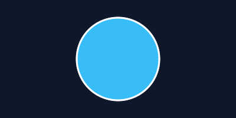

Almost every method returns an image, so you can chain operations.

### Copying and Mutation

There's one rule in this module that's worth learning before anything else,
because everything else follows from it:

> **Operations that change the size of an image return a new image.
> Everything else changes the image in place.**

`resize()`, `crop()`, `rotate()`, `flip()`, `transpose()` and `pad()` all
leave the original image unchanged and return a new one. Drawing, filters
and compositing all change the image you call them on, and return it so you
can keep chaining.

```zuri
var original = Image.open('photo.jpg')

var small = original.thumbnail(200, 200) # original is untouched
small.grayscale() # small is now grey

echo original.size() # still the full size, still colour
```

This means a chain that mixes both kinds of operation works as you'd expect,
and that you should call `clone()` when you want to keep a copy of an image
before applying a filter.

```zuri,ignore
var greyed = photo.clone().grayscale() # photo keeps its colour
```

## Colors

### Writing a Color

Wherever a color is expected, you can write it in five different ways. These
all mean the same red:

```zuri,ignore
image.fill(Color(255, 0, 0))
image.fill('#ff0000')
image.fill('red')
image.fill(0xFF0000FF)
image.fill([255, 0, 0])
```

Hexadecimal strings can have any of the four lengths CSS allows, with or
without the leading `#`: `#f00`, `#f00c`, `#ff0000` and `#ff0000cc`. Color
names come from the full CSS Color Level 4 list, and they're matched
regardless of case, spaces and hyphens, so `'Dark Sea Green'` and
`'darkseagreen'` are the same color.

Alpha ranges from 0 (transparent) to 255 (opaque), as in CSS and PNG.

### The Color Class

`Color` is an immutable value type. Every method that would change a color
returns a new one instead, so it's safe to pass a color stored in a variable
to other code.

```zuri
import imagine { Color }

var brand = Color.hex('#4f46e5')

brand.r # 79
brand.to_hex() # '#4f46e5'
brand.to_packed() # 0x4F46E5FF

brand.with_alpha(128) # half transparent
brand.fade(0.5) # halves whatever alpha it already had
brand.lighten(20) # 20 percentage points of HSL lightness
brand.darken(20)
brand.saturate(15)
brand.desaturate(15)
brand.rotate_hue(180)
brand.mix('white', 0.25) # a quarter of the way to white
brand.invert()
brand.to_grayscale()
```

`over()` blends a semi-transparent color with a background color, which is
what happens when you draw it on top of something solid:

```zuri
Color(255, 0, 0, 128).over('white') # '#ff7f7f'
```

### Color Spaces

The conversions come from the [`colors`](ch13-00-stdlib-tour.md#colors)
module, so they follow the same conventions that module and CSS use: hue in
degrees, and everything else in percentage points from 0 to 100.

```zuri
Color.hsl(240, 100, 50) # '#0000ff'
Color.hsv(120, 100, 100) # '#00ff00'
Color.hwb(0, 0, 0) # '#ff0000'
Color.cmyk(0, 100, 100, 0) # '#ff0000'
Color.lab(40.7, 50.6, -79.1) # perceptually uniform
Color.xyz(0.2, 0.15, 0.7)

brand.to_hsl() # { h: 243.4, s: 75.4, l: 58.6, a: 255 }
brand.to_hsv()
brand.to_hwb()
brand.to_cmyk()
brand.to_lab()
brand.to_xyz()
```

Lab is the right color space for interpolating between two colors when the
steps in between need to look evenly spaced. CMYK here is a simple
conversion without an output profile, so it's fine for generating colors but
not for predicting what a printing press will produce.

### Contrast and Accessibility

```zuri
var background = Color.hex('#1e293b')

background.luminance() # 0 to 1, WCAG relative luminance
background.contrast_ratio('#ffffff') # 1 to 21
background.is_dark() # true
background.best_contrast() # white, since the background is dark
```

WCAG requires a contrast ratio of at least 4.5 for normal text and 3 for
large text, so `best_contrast()` is a quick way to choose a readable text
color for a background you didn't pick:

```zuri,ignore
var label = swatch.best_contrast('#ffffff', '#111111')

card.text(20, 20, name, font, label)
```

## Loading and Saving

### Opening an Image

```zuri,ignore
var photo = Image.open('photo.jpg') # from a path
var photo = Image.open(file('photo.jpg')) # from an open file
var photo = Image.decode(upload) # from bytes in memory
```

The format is detected from the file's contents rather than its name, so a
file with the wrong extension still opens. When the contents can't be
identified, which happens with TGA because it has no signature,
`Image.open()` falls back to the file extension.

`Image.decode()` accepts options:

```zuri,ignore
Image.decode(upload, { format: 'png' }) # fail unless it really is a PNG
Image.decode(raw, { orient: false }) # skip EXIF auto-rotation
```

It's worth naming the format explicitly when you already know it from a
`Content-Type` header or a file extension. If a file claims to be a PNG but
is really something else, decoding then fails with an error instead of
decoding the file as whatever it actually is.

### Checking Before Decoding

A decoded image takes four bytes per pixel, so a 6000x4000 photo takes up 96
MB in memory, however small the file was. For any image that comes from
outside your program, read the header first:

```zuri,ignore
import imagine
import imagine { Image }

var header = imagine.probe(upload)

if header == nil {
  raise Error('that is not an image')
}

if header.width * header.height > 40000000 {
  raise Error('image is too large')
}

var photo = imagine.decode(upload)
```

`probe()` returns `{format, width, height}`, or `nil`. It only reads the
header, which takes microseconds, while decoding the same file takes tens of
milliseconds. If you only need the format name, use `imagine.detect()`.

### Saving

```zuri,ignore
photo.save('out.png')
photo.save('out.jpg', { quality: 90 })
photo.save('out.dat', { format: 'webp' }) # extension overridden
```

The format is taken from the file extension unless you set `format`. To get
the encoded bytes instead of writing a file:

```zuri,ignore
var data = photo.encode('webp')
var data = photo.to_png()
var data = photo.to_jpeg(90)
```

`encode()` without a format uses the format the image was decoded from, or
PNG for an image created in memory.

### Format Reference

| Format | Read | Write | Alpha | Notes |
|---|---|---|---|---|
| PNG | Yes | Yes | Yes | Lossless. The safe default. |
| JPEG | Yes | Yes | No | Lossy. Best for photos. |
| WebP | Yes | Yes | Yes | **Written losslessly**, so smaller than PNG but larger than a lossy WebP. |
| AVIF | No | Yes | Yes | Smallest files, slowest to encode. |
| GIF | Yes | Yes | 1-bit | 256 colors. The only animated format that can be written. |
| BMP | Yes | Yes | Yes | Uncompressed and very large. |
| TIFF | Yes | Yes | Yes | Common in printing and scanning. |
| TGA | Yes | Yes | Yes | No signature, so it needs an extension or an explicit format. |
| QOI | Yes | Yes | Yes | Lossless, and several times faster than PNG. |
| ICO | Yes | Yes | Yes | Icon container. |
| PNM | Yes | Yes | No | Very simple, and very large. |
| WBMP | Yes | Yes | No | One bit per pixel. |

Three of these need some explanation.

**AVIF can only be written.** Opening an AVIF file raises a `DecodeError`.

**TGA has no magic number**, so the only ways to identify it are by its file
extension or by naming the format explicitly.

**WebP is written losslessly.** Reading supports both lossy and lossless
WebP, but the encoder only writes lossless WebP. That means `quality` has no
effect, and a photo saved as WebP will be larger than one saved by a tool
that writes lossy WebP. For photos where file size matters, JPEG or AVIF is
a better choice. Here, WebP is best used as a lossless format with alpha
that produces smaller files than PNG.

Rather than assuming which formats are available, ask:

```zuri
import imagine

var can = imagine.capabilities()

echo can.decode.contains('png')
echo can.encode.contains('webp')
echo can.animated.contains('gif')
```

```console
true
true
true
```

`decode`, `encode` and `animated` are each a list of format names, so you
can use `contains()` to check for the format you need.

### Encoding Options

| Option | Formats | Meaning |
|---|---|---|
| `quality` | JPEG, AVIF | From 1 to 100. The default is 85 for JPEG and 80 for AVIF. |
| `compression` | PNG | `'fast'`, `'default'` or `'best'`. All of them are lossless. |
| `speed` | AVIF, GIF | For AVIF, 1 to 10, where lower is slower and gives smaller files. For GIF, 1 to 30, where lower is slower and chooses better colors. The GIF default is 15. |
| `background` | JPEG | The color that transparent pixels are blended with. The default is white. |
| `threshold` | WBMP | The brightness cutoff, from 0 to 255. |

JPEG has no alpha channel, so transparency has to be removed when you save.
Transparent pixels are blended with `background` instead of simply being
dropped, because dropping the alpha channel would turn transparent pixels
black:

```zuri,ignore
logo.save('logo.jpg', { background: '#ffffff' })
```

To see the result first, or to choose the background color once and reuse
it, do it explicitly:

```zuri,ignore
logo.flatten('#ffffff').save('logo.jpg')
```

### Data URLs

```zuri,ignore
var url = icon.to_data_url('png')
# 'data:image/png;base64,iVBORw0...'
```

Base64 encoding makes the data about a third larger than the raw image, so
data URLs are best for icons and small graphics, not photos.

## Resizing and Reshaping

### Choosing a Resize

There are six ways to resize an image, and choosing the right one is most of
the work:

| Method | Keeps the aspect ratio | Enlarges | Result |
|---|---|---|---|
| `resize(w, h)` | No | Yes | Exactly `w x h`, possibly distorted |
| `scale(factor)` | Yes | Yes | The same image, scaled by `factor` |
| `thumbnail(w, h)` | Yes | **No** | Fits inside the box |
| `fit(w, h)` | Yes | Yes | Fits inside the box |
| `cover(w, h)` | Yes | Yes | Fills the box, cropping whatever doesn't fit |
| `contain(w, h)` | Yes | Yes | Fits inside the box, padding the rest |

For thumbnails, `thumbnail()` is usually what you want, precisely because it
never enlarges. Scaling a small image up to fill a thumbnail box only makes
it blurry. Use `fit()` when you do want small images scaled up.

`cover()` and `contain()` both produce exactly the size you ask for. The
difference is what they give up. `cover()` cuts off part of the image, while
`contain()` adds bars:

```zuri,ignore
photo.cover(300, 300) # crops to a square
photo.cover(300, 300, { anchor: TOP }) # keeps the top, crops the bottom
photo.contain(300, 300, { background: 'white' }) # letterboxes instead
```

Here's the same 320x180 image resized to 120x120 in four different ways:

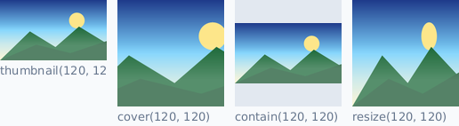

`thumbnail()` keeps the proportions and doesn't fill the box. `cover()`
fills the box and cuts off the sides. `contain()` fills the box and adds
bars. `resize()` fills the box by distorting the image.

The anchors are `TOP_LEFT`, `TOP`, `TOP_RIGHT`, `LEFT`, `CENTER`, `RIGHT`,
`BOTTOM_LEFT`, `BOTTOM` and `BOTTOM_RIGHT`. `CENTER` is the default. Use
`TOP` for photos of people, since faces are rarely in the bottom third.

### Resampling Filters

| Filter | Speed | Use it for |
|---|---|---|
| `NEAREST` | Fastest | Pixel art, QR codes and anything whose edges must stay sharp. |
| `BILINEAR` | Fast | Cases where speed matters more than sharpness. |
| `BICUBIC` | Moderate | Photos, as a good general choice. |
| `GAUSSIAN` | Moderate | Softer results, for noisy images or before sharpening. |
| `LANCZOS` | Slowest | Thumbnails and any large reduction. This is the default. |

```zuri,ignore
photo.thumbnail(200, 200, LANCZOS)
sprite.scale(4, NEAREST) # keeps pixel art crisp
```

Here's a 16x16 sprite enlarged seven times, so that the differences are easy
to see:

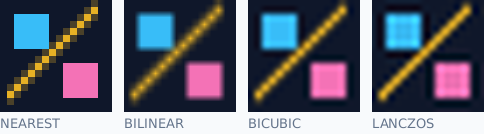

In this case, `NEAREST` is the right choice and the others are wrong. When
you shrink a photo, the opposite is true.

`LANCZOS` is the default because most resizing makes images smaller, which
is where its extra cost pays off. It can produce faint ringing next to edges
with very high contrast, which is the price of its sharpness. If that's
visible, use `BICUBIC` instead.

### Cropping, Padding and Trimming

```zuri,ignore
photo.crop(100, 50, 400, 300) # x, y, width, height
photo.pad(20) # 20 pixels on every side
photo.pad(10, 20, 10, 20, 'white') # top, right, bottom, left, colour
photo.trim() # remove a uniform border
photo.trim({ tolerance: 8 }) # allow for JPEG noise in the border
```

`crop()` requires the rectangle to fit inside the image, and raises a
`BoundsError` if it doesn't. If a crop that went past the edge were clamped
instead, you'd get back different dimensions from the ones you asked for,
which would be more surprising than an error. If the region really is meant
to extend past the edge, pad the image first.

`trim()` takes the border color from the top-left pixel, unless you specify
one. Scanned documents and screenshots nearly always need a tolerance,
because a "white" border saved in a lossy format isn't exactly white.

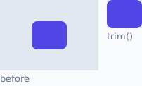

### Rotating and Mirroring

```zuri,ignore
photo.rotate_90() # lossless
photo.rotate_180()
photo.rotate_270()
photo.rotate(37, 'white') # resamples, grows the canvas

photo.flip_horizontal()
photo.flip_vertical()
photo.flip(FLIP_BOTH)
photo.transpose() # reflect across the main diagonal
```

Quarter turns are exact, because every pixel is moved without being
resampled. Any other angle uses interpolation, and enlarges the canvas to
fit the rotated corners, filling the gaps with `background`.

### EXIF Orientation

Phone cameras usually record the camera's orientation in the file instead of
rotating the pixels, so a photo whose pixels are sideways is meant to be
displayed upright. `Image.open()` and `Image.decode()` take care of this for
you.

```zuri
Image.open('photo.jpg') # upright
Image.open('photo.jpg', { orient: false }) # exactly as stored
```

All eight orientation values are supported, including the four mirrored ones
produced by scanners and some front-facing cameras.

## Filters

Filters change the image in place and return it, so you can chain them.

```zuri,ignore
photo.grayscale().contrast(15).sharpen(0.5)
```

### Tone and Exposure

```zuri,ignore
photo.brightness(20) # -255 to 255, added to each channel
photo.contrast(15) # -100 to 100, around mid-grey
photo.gamma(1.2) # above 1 lifts midtones, below 1 lowers them
photo.levels(20, 235) # stretch this input range to full scale
photo.levels(20, 235, 1.1) # ...with a midtone curve
photo.threshold(128) # every pixel to black or white
photo.posterize(6) # six evenly spaced steps per channel
photo.invert() # a photographic negative
photo.opacity(0.5) # scale the alpha channel
```

`levels()` is the most useful single correction for a flat or washed-out
photo. Everything at or below the black point becomes black, everything at
or above the white point becomes white, and the range in between is
stretched to cover the full scale.

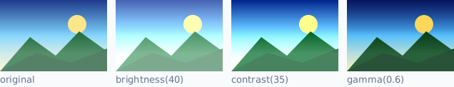

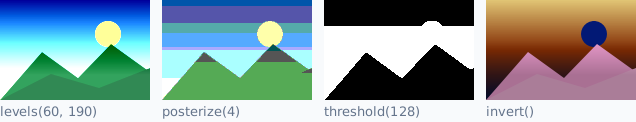

Note the difference between `posterize()` and `quantize()`. `posterize()`
spaces its levels evenly, while `quantize()` chooses colors that suit the
image, so a photo still looks good with far fewer colors.

```zuri,ignore
photo.quantize(32) # 32 well-chosen colours
photo.quantize(16, true) # ...with dithering
```

`auto_levels()` does the same job as `levels()`, but works out the black and
white points for you. It's shown alongside the detail filters below.

### Color

```zuri,ignore
photo.grayscale()
photo.sepia()
photo.saturate(1.4) # 0 removes colour, 1 is unchanged
photo.hue_rotate(45)
photo.tint('#ff8800', 0.3) # blend a flat colour in
photo.colorize('#4f46e5') # monochrome in one colour
photo.duotone('#1e1b4b', '#fbbf24')
photo.flatten('white') # composite over a colour, drop alpha
```

`grayscale()` weights each channel according to how bright it looks to the
eye, so a bright yellow becomes light gray and a deep blue becomes dark
gray. That's different from `saturate(0)`, which keeps the HSL lightness and
turns both into a medium gray.

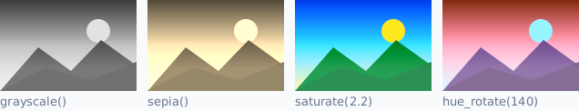

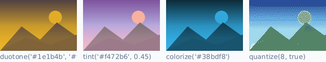

### Blur, Sharpen and Detail

```zuri,ignore
photo.blur(3) # Gaussian; the argument is its sigma
photo.sharpen(0.8)
photo.smooth() # a cheap, harsher 3x3 average
photo.emboss()
photo.edges()
photo.mean_removal()
photo.pixelate(12)
```

`blur()` is a true separable Gaussian blur, so its cost grows linearly with
the radius rather than with its square. The argument is the standard
deviation: about two thirds of each pixel's influence falls within that
distance, and the visible spread is roughly three times as far.

Alpha is premultiplied while the blur runs, so blurring a shape on a
transparent background doesn't add a dark halo around its edge.

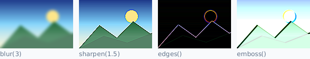

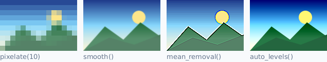

### Writing Your Own Filter

Almost every filter above is built from one of three basic operations with
different numbers plugged in, and you can use all three directly.

**A lookup table** handles any tone curve applied to each channel. The table
is built once, whatever the size of the image, and then applied at memory
speed.

```zuri,ignore
import imagine { filters }

# A gentle S-curve: more contrast, but the highlights survive.
var curve = filters.build_lut(@(value) {
  var t = value / 255
  return 255 * t * t * (3 - 2 * t)
})

photo.apply_lut(curve, curve, curve, nil) # nil leaves alpha alone
```

**A color matrix** handles anything that mixes channels, such as saturation,
hue rotation, swapping channels or tinting. It's the same 4x5 matrix that
SVG and CSS filters use, written row by row, and the last entry in each row
is a constant in units from 0 to 255.

```zuri,ignore
# Swap the red and blue channels.
photo.apply_matrix([0, 0, 1, 0, 0, 0, 1, 0, 0, 0, 1, 0, 0, 0, 0, 0, 0, 0, 1, 0])
```

Applying several matrices one after another is both slower and less accurate
than combining them and applying the result once:

```zuri,ignore
var both = filters.combine_matrices(
  filters.grayscale_matrix(),
  filters.saturation_matrix(1.2),
)

photo.apply_matrix(both)
```

**A convolution kernel** handles anything that reads the neighbors of each
pixel.

```zuri,ignore
photo.convolve([0, -1, 0, -1, 5, -1, 0, -1, 0])
```

The kernel must be square, with an odd number of rows and columns. The
default divisor of 0 means "divide by the sum of the kernel", which is what
almost every published kernel expects.

There's one trap to be aware of. The alpha channel goes through the kernel
along with the color channels. That's right for a blur, but wrong for any
kernel whose weights don't add up to one. Applied to an image that's
completely opaque, a Laplacian kernel adds up to zero, which would make the
entire result invisible:

```zuri,ignore
photo.convolve(filters.edge_kernel(), { divisor: 1, keep_alpha: true })
```

The built-in `edges()`, `emboss()`, `sharpen()` and `mean_removal()` already
handle this.

Here are the S-curve and the channel-swap matrix from this section, applied
to the same image:

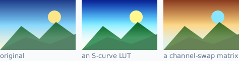

`edge` controls what happens beyond the border of the image. `EDGE_CLAMP`,
the default, repeats the nearest pixel on the edge. `EDGE_TRANSPARENT`
treats the area outside as empty, and `EDGE_WRAP` wraps around to the
opposite side, for images that are meant to tile.

## Drawing

### Shapes

Coordinates start at the top-left corner. Whole-number coordinates fall on
the corners of pixels, not their centers, so a rectangle from (0, 0) to (10,
10) covers exactly the first ten pixels in each direction.

```zuri,ignore
image.pixel(x, y, color) # one pixel, blended
image.line(x1, y1, x2, y2, color)
image.rect(x, y, w, h, color) # outline
image.fill_rect(x, y, w, h, color)
image.rounded_rect(x, y, w, h, radius, color)
image.fill_rounded_rect(x, y, w, h, radius, color)
image.circle(cx, cy, r, color)
image.fill_circle(cx, cy, r, color)
image.ellipse(cx, cy, rx, ry, color)
image.fill_ellipse(cx, cy, rx, ry, color)
image.arc(cx, cy, rx, ry, start, end, color)
image.pie(cx, cy, rx, ry, start, end, color) # closed through the centre
image.chord(cx, cy, rx, ry, start, end, color) # closed along the chord
image.bezier(x1, y1, cx1, cy1, cx2, cy2, x2, y2, color)
```

Angles are in degrees, measured clockwise from three o'clock, which matches
the direction of the y axis.

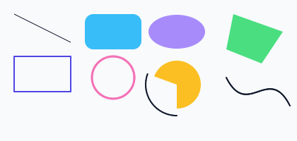

Drawing outside the image is never an error, because anything outside is
simply clipped. That makes it safe to draw a shape that only partly overlaps
the image.

### Strokes and Anti-aliasing

```zuri,ignore
image.thickness(4) # applies to every subsequent stroke
image.antialias(false) # hard edges
```

Both are set on the image rather than passed to each call, although a single
call can override the thickness:

```zuri,ignore
image.line(0, 0, 100, 100, 'black', { thickness: 8 })
```

Strokes are centered on the path, so a thickness of 4 puts 2 pixels on each
side. The corners and the ends of an open path are rounded.

Anti-aliasing is on by default. Turn it off when the output has to be exact
to the pixel, such as for barcodes, QR codes, or anything you'll apply a
threshold to later.

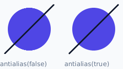

Here are stroke widths of 1, 3, 6 and 12:

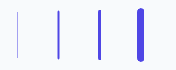

### Line Caps

How an open stroke ends is set separately from its width:

```zuri,ignore
image.cap(CAP_ROUND) # a half-disc. The default.
image.cap(CAP_SQUARE) # a square, reaching the same distance
image.cap(CAP_BUTT) # stops dead at the endpoint
```

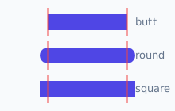

The red marks show the exact coordinates of the line. A round or square cap
extends half the stroke's width past them, and a butt cap doesn't.

Use `CAP_BUTT` whenever the coordinates need to mean exactly what they say,
such as for segments that meet end to end, a scale bar of a known length, or
the pieces of a dashed line. `CAP_SQUARE` extends as far as a round cap
does, but with a flat end.

A single call can override the image's setting:

```zuri,ignore
image.line(40, 200, 40, 40, '#334155', { thickness: 6, cap: CAP_BUTT })
```

The joins *between* the segments of a path are always round, and closed
outlines don't have ends, so neither is affected by this setting.

### Paths and Polygons

Every filled shape in this module is turned into a polygon and drawn by the
same scanline rasterizer, and every outline is turned into the polygon
around its stroke and drawn the same way. To draw a shape that isn't listed
above, provide its points:

```zuri,ignore
image.fill_polygon([
  [10, 10],
  [90, 30],
  [50, 80],
], '#4f46e5')
image.polygon([
  [10, 10],
  [90, 30],
  [50, 80],
], 'black') # outline, closed
image.polyline([
  [10, 10],
  [90, 30],
  [50, 80],
], 'black') # not closed
```

The points can be a list of `[x, y]` pairs or a flat list of alternating x
and y values. Depending on where the points came from, one or the other will
be more convenient. The outline is closed for you, so the last point doesn't
need to repeat the first.

Outlines that cross themselves are filled using the nonzero winding rule,
which fills a five-pointed star completely. Pass `{ even_odd: true }` to use
the other rule, which leaves the middle of the star empty.

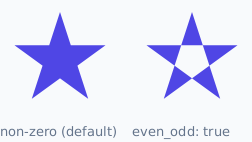

### Filling Areas

```zuri,ignore
image.fill('#0f172a') # every pixel, ignoring the clip
image.clear() # every pixel to transparent
image.flood_fill(x, y, color)
image.flood_fill(x, y, color, 12) # with a tolerance
```

Gradients are described in [their own section](#gradients) below.

`fill()` replaces pixels rather than blending with them, so filling with a
transparent color clears the image instead of leaving it unchanged.

A flood fill spreads in four directions (up, down, left and right, but not
diagonally) through pixels whose color is within `tolerance` of the color at
the starting point. A tolerance of 0 only spreads through pixels that are
exactly the same color, so for a photo or anything anti-aliased, you'll need
a higher value.

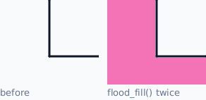

### Gradients

```zuri,ignore
image.linear_gradient(x1, y1, x2, y2, stops)
image.radial_gradient(cx, cy, radius, stops)
```

A linear gradient runs along the line from the first point to the second.
Everything before that line gets the color of the first stop, and everything
after it gets the color of the last stop, so a short line across a large
area produces a sharp transition with solid bands on either side.

```zuri,ignore
# top to bottom
image.linear_gradient(0, 0, 0, image.height(), ['#0f172a', '#334155'])

# diagonal, three colours
image.linear_gradient(0, 0, 400, 200, ['#4f46e5', '#f472b6', '#fbbf24'])
```

The stops can be plain colors, which are spaced evenly, or `[offset, color]`
pairs, where the offset ranges from 0 to 1:

```zuri,ignore
image.linear_gradient(0, 0, 200, 0, [
  [0, 'black'],
  [0.25, 'red'],
  [1, 'white'],
])
```

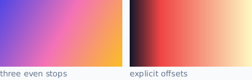

By default, a gradient replaces what's already there. Pass `{ blend: true }`
to blend it with the image instead, which is how you make overlays and
vignettes:

```zuri,ignore
# a vignette over an existing photograph
photo.radial_gradient(
  photo.width() / 2,
  photo.height() / 2,
  photo.width() * 0.7,
  [
    [0, Color(0, 0, 0, 0)],
    [1, Color(0, 0, 0, 180)],
  ],
  { blend: true },
)

# a caption scrim along the bottom
photo.linear_gradient(
  0,
  photo.height() - 120,
  0,
  photo.height(),
  [Color(0, 0, 0, 0), Color(0, 0, 0, 200)],
  { blend: true },
)
```

`{ rect: {x, y, width, height} }` limits the gradient to a rectangle instead
of covering the whole image.

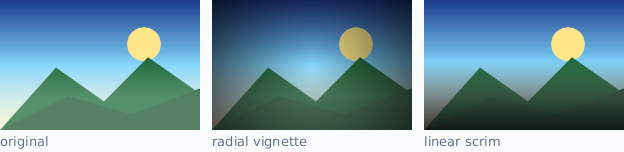

Both of these come from the snippets above, applied to the image on the
left.

### Clipping

```zuri,ignore
image.clip(20, 20, 100, 100)
image.fill_rect(0, 0, 500, 500, 'red') # only the clip is painted
image.clear_clip()
```

A clip limits every drawing operation to a region until you clear it. It
doesn't affect reading, so `get_pixel()` can see the whole image either way.

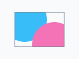

## Text

### The Built-in Font

`imagine` doesn't include any font files, so everything in the next section
depends on the fonts installed on the machine, and it can fail. One font
always works:

```zuri
import imagine { Image, StrokeFont }

Image(
  300,
  70,
  'white',
).text(16, 20, 'Always available', StrokeFont(28), '#0f172a').save('label.png')
```

`Font.builtin(size)` gives you the same font, under a name you'll find on
`Font`.

It isn't a font file. Every glyph is defined as geometry, using center-line
strokes instead of filled outlines, in
[`libs/imagine/strokefont.zu`](https://github.com/zuri-lang/zuri/blob/main/libs/imagine/strokefont.zu),
and it's drawn with the same anti-aliased rasterizer as everything else.
That means it scales cleanly to any size, and its weight is a parameter
rather than part of the design:

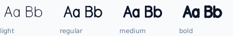

```zuri
StrokeFont(24) # regular
StrokeFont(24).weight(0.13) # bold
StrokeFont(24).weight(0.05) # light
```

Here's the complete character set:

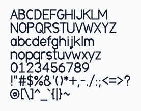

**What it's for.** Labels, chart axes, watermarks, diagrams, placeholder
text, and any output that has to work on a machine without fonts installed.
It looks geometric and has a single weight, more like a technical drawing
than a typeface, because that's what center-line strokes naturally produce.

**What it's not for.** Body text, headlines or anything where the shapes of
the letters matter. Load a real font for those.

**It covers** printable ASCII, from the space character to `~`. Any other
character is drawn as the empty box that fonts use for missing glyphs, so
text in another script is visibly missing rather than silently blank.

A `StrokeFont` has the same interface as a `Font`, with `size()`,
`metrics()`, `measure()`, `render()` and `wrap()`, so you can use either one
anywhere a font is accepted.

### Loading a Font

```zuri,ignore
import imagine { Font }

var font = Font.load('assets/Inter.ttf', 24)
var font = Font.from_bytes(embedded_font, 24)
var font = Font.system('DejaVu Sans', 24)
var font = Font.sans(24)
```

`Font.load()` reads a TrueType or OpenType file and caches the parsed font
by its path, so loading the same file twice in one process only parses it
once. `Font.system()` searches the platform's font directories for a family
name, ignoring case, spaces and hyphens.

`Font.sans()` finds whichever common sans-serif font is installed. It's
handy for scripts and tests, but don't rely on it for output that has to
look the same everywhere, because the font it finds depends on the machine,
and a container image without fonts won't have any to find. In that case, it
raises a `FontError` that suggests `Font.builtin()`, which never depends on
what's installed.

A `Font` is immutable and cheap to copy. `size()` returns the same font at a
different size, sharing the parsed data:

```zuri,ignore
var title = font.size(32)
var body = font.size(14)
```

### Drawing Text

```zuri,ignore
image.text(20, 20, 'Hello', font, '#111111')
```

`x` and `y` are the top-left corner of the text's bounding box, not its
baseline, because the corner is what you usually know when you place text in
a layout. Pass `{ baseline: true }` if you want `y` to be the baseline of
the first line instead.

A `\n` starts a new line.

```zuri,ignore
card.text(24, 24, 'Quarterly report\n2026', title, '#111111', {
  align: ALIGN_CENTER,
  line_height: 1.4,
  tracking: 0.5,
})
```

`align` positions the lines relative to each other, not relative to the
image. `line_height` is a multiplier applied to the font's recommended line
spacing, and `tracking` adds space between characters, in pixels.

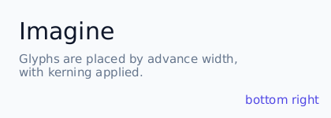


### Measuring and Positioning

```zuri,ignore
var box = image.text_size('Hello', font)
# { width: 58, height: 28, baseline: 22.3, lines: 1 }
```

Measuring text takes a fraction of the time it takes to draw it, so measure
first when you lay out text, whether you're centering it, wrapping it or
sizing a background to fit.

```zuri,ignore
var box = card.text_size(label, font)

card.fill_rounded_rect(16, 16, box.width + 24, box.height + 16, 8, '#1e293b')
card.text(28, 24, label, font, 'white')
```

To position text by anchor instead of coordinates:

```zuri,ignore
card.place_text('SOLD OUT', font, 'white', CENTER)
card.place_text('v2.1', font, '#94a3b8', BOTTOM_RIGHT, { margin: 12 })
```

### Wrapping

```zuri,ignore
var body = Font.load('assets/Inter.ttf', 16)

page.text(40, 120, article, body, '#334155', { width: 520 })
```

The `width` option wraps the text to that many pixels before drawing it.
`text_size()` accepts the same option, so measuring wrapped text gives you
the size of the box it will actually take up.

To get the wrapped text itself, so you can store it or draw it in pieces,
call `wrap()` on the font:

```zuri,ignore
var lines = body.wrap(article, 520).split('\n')

echo '${lines.length()} lines'
```

Newlines in the text are kept as paragraph breaks, and runs of spaces are
collapsed into one. Words are kept whole where possible. A single word
that's too long for the width is broken between characters instead of being
allowed to overflow, because text that runs off the edge of an image can't
be scrolled into view.

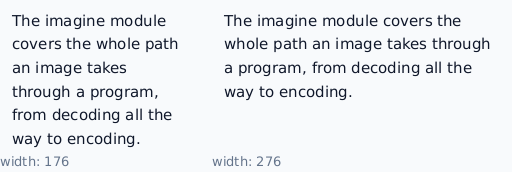

### Text Layout Limitations

Glyphs are positioned by their advance widths, with kerning applied. That
works for Latin, Greek, Cyrillic and any other script written left to right
without contextual shaping.

Complex shaping isn't supported. Arabic letters won't join, Indic clusters
won't be reordered, and ligatures aren't substituted. All of those need a
shaping engine.

## Compositing

### Drawing One Image Onto Another

```zuri,ignore
photo.draw_image(logo, 20, 20)
photo.draw_image(logo, 20, 20, { opacity: 0.6 })
photo.place(logo, BOTTOM_RIGHT, { margin: 16, opacity: 0.5 })
```

The source image is clipped to the destination, and its position can be
negative, so a sprite that hangs off the top-left corner is drawn correctly.
You can composite an image onto itself, because it's copied first.

### Blend Modes

```zuri,ignore
photo.draw_image(texture, 0, 0, { blend: BLEND_MULTIPLY })
```

| Mode | Effect |
|---|---|
| `BLEND_NORMAL` | Ordinary alpha compositing. This is the default. |
| `BLEND_MULTIPLY` | Never lighter than either input. Good for shadows. |
| `BLEND_SCREEN` | Never darker than either input. Good for glows. |
| `BLEND_OVERLAY` | Multiply in the shadows, screen in the highlights. |
| `BLEND_DARKEN` / `BLEND_LIGHTEN` | Keeps the darker or lighter value of each channel. |
| `BLEND_COLOR_DODGE` / `BLEND_COLOR_BURN` | Strong brightening or darkening. |
| `BLEND_HARD_LIGHT` / `BLEND_SOFT_LIGHT` | Overlay with the roles of the two images reversed, and a gentler version of it. |
| `BLEND_DIFFERENCE` / `BLEND_EXCLUSION` | The absolute difference, and a version with lower contrast. |
| `BLEND_ADD` / `BLEND_SUBTRACT` | Adds or subtracts, clamping the result. |

The formulas come from the CSS compositing specification, which is also what
image editors use.

`BLEND_DIFFERENCE` gives you a quick visual diff, because two identical
images blended this way produce black.

Here's a red circle drawn onto a gradient with eight of the modes:

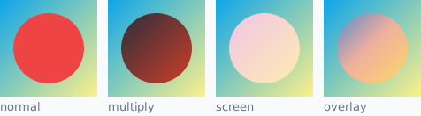


```zuri,ignore
var diff = before.clone().draw_image(after, 0, 0, { blend: BLEND_DIFFERENCE })
```

Drawing operations such as lines, shapes and text always use ordinary alpha
compositing. To draw a shape with a blend mode, draw it on a layer and then
composite the layer.

### Masks

```zuri,ignore
var stencil = photo.layer()
stencil.fill_circle(200, 200, 150, 'white')

photo.mask(stencil) # everything outside the circle becomes transparent
```

Each pixel keeps its color and takes its transparency from the mask. Opaque
white lets the image show through completely, black or transparent hides it,
and shades of gray make it partly transparent. The mask's own alpha channel
is taken into account, so a shape drawn on a transparent background works as
a mask without being filled in first.

The mask has to be the same size as the image.

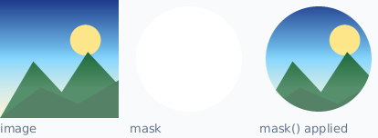

### Layers

`layer()` returns a transparent image of the same size. Building a composite
from layers lets you create effects that a single pass can't, and it's the
way to apply a blend mode or an opacity to a group of operations instead of
just one:

```zuri,ignore
var glow = photo.layer()

glow.fill_circle(200, 150, 80, '#fbbf24')
glow.blur(30)

photo.draw_image(glow, 0, 0, { blend: BLEND_SCREEN, opacity: 0.7 })
```

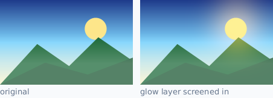

## Inspecting an Image

```zuri,ignore
photo.width() # dimensions
photo.height()
photo.size() # { width, height }
photo.bounds() # { x: 0, y: 0, width, height }
photo.format() # what it was decoded from, or nil
photo.is_opaque() # walks the alpha channel
photo.info() # all of the above, plus a pixel count
```

Apart from the dimensions, there are four methods that tell you about the
contents of an image.

**`histogram()`** counts how many pixels have each value, and returns four
lists of 256 entries: `red`, `green`, `blue` and `luma`. Completely
transparent pixels are skipped, since you can't see their color. A histogram
tells you whether an image is underexposed (most values at the low end),
flat (most values in the middle) or clipped (a spike at 0 or 255).

**`auto_levels()`** is an automatic version of `levels()`. It finds the
black and white points from the brightness histogram and stretches the range
between them, ignoring a small fraction at each end so that a few stray
pixels can't affect the result.

```zuri,ignore
photo.auto_levels()
photo.auto_levels({ clip: 0.02, gamma: 1.1 })
```

**`average_color()`** returns the average color, weighting each pixel by its
alpha, so a mostly transparent image reports the color of the part you can
see.

**`dominant_colors()`** returns the colors that take up the largest part of
the image, starting with the most common. The image is first shrunk and
reduced to a small palette, so this costs about the same whatever the size
of the original.

```zuri,ignore
var accent = photo.dominant_colors(1)[0]

page.fill(accent.darken(40)) # a placeholder while the photo loads
```


**`difference()`** measures how different two images are, from 0 (identical)
to 1, which makes it useful in tests that check rendered output:

```zuri,ignore
if rendered.difference(expected) > 0.01 {
  raise Error('the rendering changed')
}
```

## Animation

```zuri,ignore
import imagine { Animation }

var animation = Animation.open('loading.gif')

animation.length() # frame count
animation.duration() # milliseconds for one pass
animation.frame(0) # one frame, as an Image
animation.frames() # the live list
```

Frames are returned already composited onto the frames before them, so you
can use frame 5 on its own without replaying the first four. You never have
to deal with the disposal and transparency rules that animated GIFs are
built from.

Creating and transforming animations:

```zuri,ignore
var frames = []

iter var i = 0; i < 30; i++ {
  var frame = Image(200, 200, 'black')
  frame.fill_circle(100, 100, i * 3, '#38bdf8')
  frames.append(frame)
}

Animation(frames, 40, 0).save('pulse.gif') # 40ms per frame, loops forever
```


```zuri,ignore
animation
    .map(@(frame) {
      return frame.grayscale().blur(1)
    })
    .repeat(3)
    .save('out.gif')
```

`map()` copies each frame before passing it to the function, so a chain of
filters works directly as the function body and the original animation isn't
changed. Because of that copy, `map()` needs as much memory again as the
animation itself. To filter frames in place, loop over `frames()` and change
each image directly.

Both animated GIF and animated WebP can be read, but only GIF can be
written. A still image is decoded as an animation with one frame instead of
raising an error, so code that handles both doesn't need separate branches.

Every frame must be the same size, because animated formats have a single
canvas that each frame is drawn onto.

## Working With Pixels Directly

`pixels()` returns the live pixel buffer. It's 8-bit RGBA with straight (not
premultiplied) alpha, stored row by row without padding, so pixel `(x, y)`
starts at byte `(y * width + x) * 4`.

```zuri,ignore
var buffer = image.pixels()
var total = buffer.length()

iter var at = 0; at < total; at += 4 {
  buffer[at] = 255 - buffer[at] # invert red only
}
```

This is intentional, and it's much faster than calling a method for every
pixel, so you can still write efficient Zuri code for operations this module
doesn't provide. Adding type annotations to the function's parameters helps
here:

```zuri
def darken_edges(pixels: bytes, width: number, height: number) {
  iter var y = 0; y < height; y++ {
    iter var x = 0; x < width; x++ {
      var at = (y * width + x) * 4
      # ...
    }
  }
}
```

`set_pixels()` takes a buffer back, which lets you save a copy before
applying a destructive filter and restore it afterwards:

```zuri,ignore
var saved = image.pixels().clone()

image.blur(8)
image.set_pixels(saved) # back where it started
```

`Image.from_pixels()` creates an image from a buffer that came from
somewhere else entirely.

## Errors

Errors fall into two groups. An argument of the wrong *type* raises a
`TypeError`, from the parameter's own type annotation. Every other error is
a subclass of `ImageError`, so one `catch` handles all of them:

```zuri
import imagine { Image, ImageError, DecodeError }

catch {
  var photo = Image.open(path)
} as e {
  if instance_of(e, DecodeError) {
    echo 'not a readable image'
  } else {
    echo 'something else went wrong: ${e.message}'
  }
}
```

| Error | Raised when |
|---|---|
| `ImageError` | The base class. It's also raised directly for invalid arguments. |
| `DecodeError` | The data isn't an image, is in a format this build can't read, or is truncated. |
| `EncodeError` | The image can't be written in the requested format. |
| `FormatError` | A format name or file extension isn't one this module recognizes. |
| `BoundsError` | A rectangle, crop or resize goes outside the image, or a dimension is less than 1. |
| `FontError` | A font can't be parsed, found or used for layout. |

Two kinds of failure are intentionally outside that hierarchy.

**An argument of the wrong type raises a `TypeError`.** Parameters declare
their types, so the check happens when the method is called, and the message
names the parameter:

```zuri,ignore
image.rotate('sideways')
# TypeError: rotate() expects parameter 'degrees' (argument 1)
#            to be a number, got string
```

**An invalid color raises a `ValueError`**, because that's what the
[`colors`](ch13-00-stdlib-tour.md#colors) module raises for it, and changing
the error type would lose the distinction between "not a color" and "not a
string":

```zuri,ignore
Color.hex('nonsense') # ValueError, from colors
Color.named('chartroose') # ValueError, from colors
Color.hex(42) # TypeError, from the type declaration
```

A value of the right type that's out of *range* still raises a subclass of
`ImageError`, because that's a judgment this module makes, not a type the
runtime can check:

```zuri,ignore
Image(0, 100) # BoundsError, not TypeError
filters.gamma_lut(-1) # ImageError
```

You should always be prepared for `DecodeError`, because any image that
comes from outside your program can cause it.

Drawing operations don't raise `BoundsError`. A line that runs off the edge
of the canvas is clipped, as in any drawing API. Only operations that have
to return an image of an exact size have no sensible way to continue.

## Performance and Memory

Every pixel takes four bytes. A 6000x4000 photo takes up 96 MB once decoded,
however small the file was, and an animation of 100 frames at 500x500 takes
up 100 MB. Call `probe()` before decoding any image whose size you don't
control.

Here's some rough guidance on what each kind of operation costs:

- **Decoding and encoding** take most of the time in almost every pipeline.
  PNG with `'best'` compression is several times slower than with
  `'default'`, and saves only a few percent in size. AVIF is slower still.
- **Resizing** costs roughly in proportion to the size of the *output*, so
  shrinking is cheap and enlarging isn't. `LANCZOS` costs a few times as
  much as `NEAREST`.
- **Blurring** costs time in proportion to the radius rather than its
  square, because the blur is separable. A 3x3 `convolve()` is cheaper than
  `blur(1)`, but by `blur(5)`, the Gaussian blur is much faster.
- **Lookup tables and color matrices** are limited by memory speed, and
  they're about as fast as anything that touches every pixel can be. You can
  chain as many as you like, but combine matrices with `combine_matrices()`
  instead of applying them one at a time. That's both faster and more
  accurate, because the intermediate result is never rounded back to 8 bits.
- **Drawing** costs in proportion to the area covered, and anti-aliasing
  samples each row of pixels four times. Turning anti-aliasing off makes a
  real difference for very large fills.

If the result is going to be smaller anyway, resize before you apply
filters. Filtering a 24-megapixel photo and then shrinking it to a thumbnail
gives the same visual result at forty times the cost.

## Recipes

**A thumbnail pipeline for uploaded images**

```zuri
import imagine
import imagine { Image, DecodeError, LANCZOS, TOP }

def make_thumbnail(upload) {
  var header = imagine.probe(upload)

  if header == nil {
    raise DecodeError('not an image')
  }

  if header.width * header.height > 50000000 {
    raise DecodeError('image too large')
  }

  return Image.decode(upload)
      .cover(400, 400, { anchor: TOP, filter: LANCZOS })
      .sharpen(0.4)
      .encode('webp')
}
```

**A rounded avatar with a border**

```zuri
import imagine { Image }

def avatar(source, size) {
  var photo = Image.decode(source).cover(size, size)

  var stencil = photo.layer()
  stencil.fill_circle(size / 2, size / 2, size / 2 - 2, 'white')
  photo.mask(stencil)

  photo.circle(size / 2, size / 2, size / 2 - 2, '#e2e8f0', { thickness: 3 })

  return photo
}
```


**A social card**

```zuri
import imagine { Image, Font, Color, ALIGN_LEFT }

def card(title, subtitle) {
  var image = Image(1200, 630, '#0f172a')
  var heading = Font.load('assets/Inter-Bold.ttf', 64)
  var body = heading.size(30)

  image.fill_rect(0, 0, 1200, 8, '#38bdf8')

  var box = image.text_size(title, heading, { align: ALIGN_LEFT })
  image.text(80, 200, title, heading, 'white', { align: ALIGN_LEFT })
  image.text(80, 200 + box.height + 24, subtitle, body, '#94a3b8')

  return image.to_png()
}
```

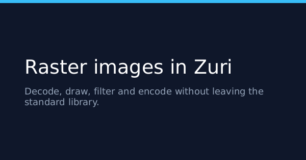

**Serving a generated image over HTTP**

```zuri,ignore
import http
import imagine { Image, Font, CENTER }
import imagine.formats

var server = http.server(8000)
var font = Font.load('assets/Inter.ttf', 20)

server.get('/badge/:label', @(request, response) {
  var image = Image(220, 60, '#1e293b')

  image.fill_rounded_rect(0, 0, 220, 60, 8, '#334155')
  image.place_text(request.param('label'), font, 'white', CENTER)

  response.content_type(formats.mime_for('png'))
  response.cache_for(86400)
  response.write(image.to_png())
})

server.listen()
```

**Comparing two images**

```zuri
import imagine { BLEND_DIFFERENCE }

def differs(a, b) {
  if a.size() != b.size() {
    return true
  }

  var diff = a.clone().draw_image(b, 0, 0, { blend: BLEND_DIFFERENCE })
  var pixels = diff.pixels()
  var total = pixels.length()

  iter var at = 0; at < total; at += 4 {
    if pixels[at] > 8 or pixels[at + 1] > 8 or pixels[at + 2] > 8 {
      return true
    }
  }

  return false
}
```
